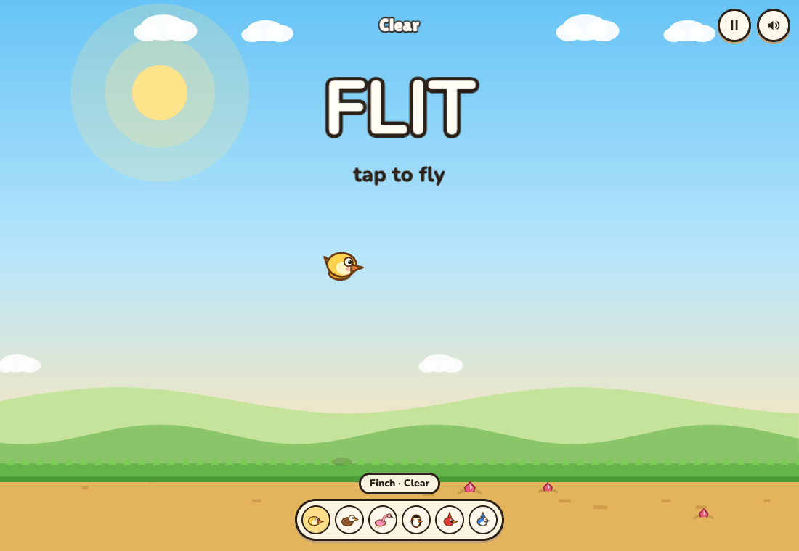

# Flit

Tap to flap. Slip through the gaps. See how long you last.

**[Play the game](https://gabe-torres.github.io/flit/)**



Flit is a one-button flyer in the tradition of Flappy Bird. [PixiJS](https://pixijs.com/) draws the bird, the gates, and the field. The sound is synthesized. The published game is still one HTML file.

## How to play

The bird falls. You keep it in the air.

- On the title, pick a bird: finch, eagle, flamingo, penguin, cardinal, or blue jay. The choice stays in this browser.
- Each run has its own weather: clear, rain, a storm with a tornado, a blizzard, a heat wave, fog, or wind. A new run rolls a new sky.
- Tap, click, or press Space, Up, or W to flap.
- Each gate you clear is one point.
- A gate or the ground ends the run.
- After the score card, tap or press Space to fly again.
- P pauses. M mutes. R returns to the title. The buttons in the corner pause and mute too.

The best score stays in this browser. A run of 5 earns bronze, 10 silver, 20 gold, and 40 a ruby. A few more rubies are buried in the dirt. They are just sitting there.

On a phone, open the play link in the browser. A texted HTML file is only a preview, and the game will not start from it. Open the play link once while you are online, then add it to the home screen. The icon is the yellow bird. After that the game runs with the network off.

## Develop

From this folder:

```bash
npm install
npm run dev
```

Open [http://localhost:5173/](http://localhost:5173/).

```bash
npm test          # checks the flight numbers
npm run build     # writes one HTML file and copies it to docs/
npm run preview   # serves that build
```

GitHub Pages serves `docs/index.html` at the play link above. The Vite entry stays `index.html`. Leave the source file alone when you publish.
